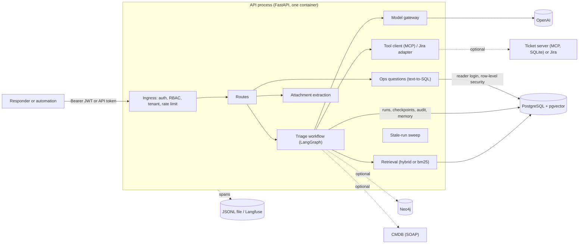

# IncidentOps AI architecture (v1.0)

IncidentOps takes an incident report, finds the runbooks and postmortems that bear on it, asks a
model for a diagnosis that must cite them, and proposes one action (a ticket) that a person
approves before anything is written. Everything the model touches is checked by code, and every
failure ends in a named state rather than a guess.

This page is the map. Each boundary below names its code, the decision record (ADR) behind it,
and what happens when it fails. The ADRs are indexed in [adr/README.md](adr/README.md); the
operator's view of the same failures is the [runbook](runbook.md).

## The picture



A triage is one run of a fixed graph (no model chooses a step):

```mermaid
flowchart LR
    intake --> retrieve & graph & recall & cmdb
    retrieve & graph & recall & cmdb --> extract & diagnose
    extract & diagnose --> assess
    assess -->|"no reason codes"| recommend
    assess -->|"any reason code"| review
    recommend & review --> approval{{"approval (interrupt)"}}
    approval -->|"approve"| act
    approval -->|"reject"| rejected
```

`extract` and `diagnose` are the only model steps; `act` is the only step that writes outside
the database. Steps that share a column run in the same super-step, and a checkpoint is written
after each one.

## Where the data lives

| Store | Holds | Required |
|---|---|---|
| PostgreSQL 17 + pgvector | incidents, idempotency keys, `llm_runs` (every model call and its cost), documents, chunks and embeddings, attachments, workflow runs, the append-only `workflow_events` and `memories`, LangGraph checkpoints, the `ops` schema | yes |
| Neo4j 5 | services, owners, on-call, dependencies, incident history (W05) | no |
| SQLite (`tickets.db`) | the bundled ticket server's tickets (W08) | no (or Jira) |
| JSONL file / Langfuse | trace spans (W11) | no |

## 1. Ingress and identity

**Code:** `apps/api/app/deps.py` (authenticate, `permit`, the per-route `Can*` permissions),
`src/incidentops_ai/auth/` (principal, JWT verification), `apps/api/app/rate_limit.py`,
`src/incidentops_ai/idempotency.py`, `apps/api/app/errors.py`.
**Decisions:** [ADR-007](adr/007-identity-tenancy-and-model-controls.md);
[threat model](threat-model.md).

- A caller sends a bearer JWT from the company identity provider (HS256 or RS256; the algorithm
  follows the configured key) or the static machine token (admin, tenant `default`).
- Four roles (`viewer`, `responder`, `approver`, `admin`) map to ten permissions, checked per route
  before anything else runs. The tenant comes from the token, never from the request body.
- Creating an incident accepts an `Idempotency-Key`; a replay returns the first result.
- Model endpoints share one per-process rate limit.

| Failure | What the caller gets |
|---|---|
| No token or JWT key configured | `503 auth_not_configured` on every route |
| Missing, expired or forged token | `401` |
| Role lacks the permission | `403 forbidden` |
| Another tenant's resource | `404 not_found` (its existence is not revealed) |
| Key reused with a different body | `409 idempotency_key_reused` |
| Rate limit | `429 rate_limit_exceeded` with `Retry-After` |
| Database down | `503 database_unavailable` |

Every error is `application/problem+json` with a stable `code`.

## 2. Retrieval

**Code:** `src/incidentops_ai/retrieval/` (`ingest`, `chunking`, `index`, `hybrid`, `bm25`,
`stack`, `store`), corpus in `data/corpus/`.
**Decisions:** W03 and W04 findings in [ROADMAP.md](ROADMAP.md); retrieval part of
[ADR-008](adr/008-evaluation-gateway-and-tracing.md); the timeout in
[ADR-009](adr/009-reliability-and-degradation.md).

- Documents are Markdown with front matter, split along their headings (each chunk an exact slice
  of the document, with its section path for citing), embedded with `text-embedding-3-small`
  (1536 dimensions) and searched exactly (no approximate index).
- The default stack is **hybrid**: dense and BM25 lists fused by reciprocal rank. It won the W04
  comparison (Recall@5 1.000 on the evaluation set); the cross-encoder reranker did not earn its
  memory. `bm25` needs no embeddings at all.
- Retrieval is filtered to the caller's tenant and returns the top five chunks as evidence
  `E1..E5`.

| Failure | Behaviour |
|---|---|
| Slower than 5 s | `retrieval_error: RetrievalTimeout`: no evidence, so the diagnosis is `no_answer`, so the run goes to review |
| Embedding or reranker call fails | `retrieval_error` names the error; the same path to review |
| Corpus never ingested | no evidence, `no_answer`, review. `GET /status` does not check this ([known limitation](known-limitations.md)) |

## 3. Knowledge graph

**Code:** `src/incidentops_ai/graph/` (`catalogue`, `load`, `neo4j_store`, `retriever`).
**Decision:** [ADR-002](adr/002-knowledge-graph.md).

The graph answers structured questions the documents cannot: who owns a service, who is on call,
what it depends on, what depends on it, and which open fixes sit upstream. The diagnosis response
shows this as `service_context`, never as a citation. It does not steer retrieval by default
(`INCIDENTOPS_GRAPH_RETRIEVAL=off`): on our questions it did not help, and hard-filtering by service
lost every dependency question.

| Failure | Behaviour |
|---|---|
| Neo4j not configured | `graph_status: "off"`; everything else unchanged |
| Neo4j down | `graph_status: "unavailable"`; the recommendation has no on-call name; `GET /status` REDUCED |

## 4. Attachments (multimodal)

**Code:** `src/incidentops_ai/multimodal/` (`attachments`, `extract`), `apps/api/app/routes/attachments.py`.
**Decision:** [ADR-003](adr/003-multimodal-routing.md).

An attachment becomes citable text by the cheapest route that is exact: a PDF's text layer, OCR
for scans, a vision model's transcript for images (OCR when no model is configured or the call
fails). Only text is cited, with the page, span or pixel box it came from. Attachments are evidence
`A1..An` for their own incident and are never indexed into the shared corpus.

| Failure | Behaviour |
|---|---|
| Over 5 MB, over 10 pages, a type the bytes do not prove, an image over Pillow's pixel limit | refused at upload (`file_too_large`, `too_many_pages`, `unsupported_media`) |
| Vision model fails | OCR transcript instead, recorded as such |
| OCR misreads | cited faithfully: a known limitation ([known-limitations.md](known-limitations.md)) |

## 5. Orchestration (the triage workflow)

**Code:** `src/incidentops_ai/workflow/` (`graph`, `runner`, `assess`), `apps/api/app/routes/workflow.py`,
`src/incidentops_ai/diagnosis/`, `src/incidentops_ai/extraction/`, `src/incidentops_ai/memory/`.
**Decisions:** [ADR-001](adr/001-llm-failure-handling.md), [ADR-004](adr/004-agentic-vs-deterministic-steps.md),
[ADR-005](adr/005-approval-gate-and-tool-trust-boundary.md), [ADR-009](adr/009-reliability-and-degradation.md).

- Two model steps, each one structured call with checked output: **extraction** (fields, with
  fixed review rules) and **diagnosis** (causes that must cite the evidence; citations are checked).
- **The route is code.** `assess` returns reason codes (`model_failed`, `no_answer`,
  `unsupported_causes`, `extraction_needs_review`, `sev1`, `integration_degraded`,
  `suspicious_evidence`); any code sends the run to review.
- **The recommendation is code**: cited runbooks, the on-call engineer, open upstream fixes.
- **Every run stops at one approval gate** (a LangGraph `interrupt`). Only
  `POST …/decision` moves it on, once, under a row lock. Decisions and notes are append-only.
- **Memory** is reviewer notes recalled as evidence `M1..M3`; a correction supersedes a note,
  never edits it.

| Failure | Behaviour |
|---|---|
| Model step fails (after the gateway's retries and fallback) | `model_failed`, review, no causes shown |
| Two decisions at once | one wins; the other gets `409 conflict` |
| Malformed decision | the gate asks again; nothing is stored |
| The process dies mid-run | the run stays `running`; the sweep marks it `failed` (`StaleRun`) after 15 minutes; resuming repeats no finished step |
| A run fails repeatedly | resumed at most 3 times, then `abandoned` |
| A graph loop | capped at 25 super-steps per invocation |

## 6. Model calls

**Code:** `src/incidentops_ai/llm/` (`gateway`, `openai_provider`, `retry`, `runs`, `tool_loop`),
`src/incidentops_ai/prompts/` (versioned prompt files), `src/incidentops_ai/security/` (`pii`,
`guard`, `injection`).
**Decisions:** [ADR-001](adr/001-llm-failure-handling.md), [ADR-007](adr/007-identity-tenancy-and-model-controls.md),
[ADR-008](adr/008-evaluation-gateway-and-tracing.md).

Every model call goes through one gateway: a route of models per task, fallback only on failures
another model could fix (timeout, rate limit, provider error), a circuit breaker per model, a
per-model rate limit, and the answering model recorded in `llm_runs` with its tokens and estimated
cost. Before a prompt is sent, PII and secrets are redacted; a canary in the system prompt catches
prompt leaks; instruction-like text in an incident is flagged and sends the run to review.

| Failure | Behaviour |
|---|---|
| Timeout, rate limit, 5xx | bounded retry with backoff (3 attempts, 60 s total), then the next model on the route |
| Invalid or cut-off output | retried once, then a named failure; never repaired |
| Bad key, unknown model, refusal | rejected at once, no retry |
| Every model on a route has its breaker open | calls fail fast; runs end `model_failed` and go to review; `GET /status` MANUAL |

## 7. Tools and integrations

**Code:** `src/incidentops_ai/tickets/` (MCP server and client, signed approvals),
`src/incidentops_ai/integrations/` (`jira`, `cmdb`), `src/incidentops_ai/ops/` (text-to-SQL),
`src/incidentops_ai/tools/` (read-only tools offered to the model).
**Decisions:** [ADR-005](adr/005-approval-gate-and-tool-trust-boundary.md),
[ADR-006](adr/006-text-to-sql-and-integration-failures.md); [integration contracts](notes/integration-contracts.md).

- **Writes need a signed approval.** The host signs the run, the decision, the reviewer and a
  fingerprint of the exact arguments; the ticket server checks the signature. Write tools are never
  offered to a model. A PostgreSQL advisory lock serialises writes per run across processes, and
  each ticket system's own idempotency (a run label, or the run id) makes a retry find the first
  ticket.
- **Text-to-SQL** runs through four independent layers: an allow-listed schema in the prompt, a
  `sqlglot` validator (one SELECT, allow-listed tables and columns, a capped LIMIT), a read-only
  login with row-level security per tenant, and a read-only transaction with a statement timeout.

| Failure | Behaviour |
|---|---|
| Ticket system times out after writing | the run is `failed`; resume finds the ticket instead of making a second |
| CMDB unavailable or invalid reply | `integration_degraded`, review; the proposal says the owner is unknown |
| SQL the validator refuses | `status: "refused"` with the rule that fired; nothing runs |
| Ops database not configured | `503 ops_not_configured` |

## 8. Observability and evaluation

**Code:** `src/incidentops_ai/observability/` (`tracing`, `langfuse`, `report`),
`src/incidentops_ai/evals/` (`layers`, `generation`, `gate`), `evals/`.
**Decision:** [ADR-008](adr/008-evaluation-gateway-and-tracing.md); results in
[reports/](reports/README.md).

One trace per run, with spans for the run, each step, each model call, retrieval and tools; errors
carry the exception type only, never its message. Exporters write JSONL or send to Langfuse.
`python -m incidentops_ai.observability.report` rebuilds a run from its trace.

Evaluation has four layers (retrieval, generation, workflow, system, plus security attacks). The
offline ones run in CI behind thresholds (`evals/thresholds.toml`); a prompt change fails the gate
until a real-model run is recorded for it.

| Failure | Behaviour |
|---|---|
| An exporter fails | logged; the request carries on (tracing never breaks a request) |
| Langfuse rejects a batch, or is unreachable | logged and counted; the batch is dropped, not retried |
| Langfuse is slow | the send is bounded at 5 s but runs on the event loop, so it can stall other requests ([known limitation](known-limitations.md)) |

## 9. Deployment

**Code:** `Dockerfile`, `docker/entrypoint.sh`, `docker-compose.yml`, `.env.example`,
`apps/api/app/main.py` (lifespan: pools, checkpointer, sweep), `apps/api/app/routes/status.py`.
**Decision:** [ADR-009](adr/009-reliability-and-degradation.md); guides: [deploy.md](deploy.md),
[deploy-lightsail.md](deploy-lightsail.md), [runbook.md](runbook.md).

One API container (unprivileged user, migrations on start) and PostgreSQL; Neo4j behind a compose
profile. Every setting in `.env.example` reaches the container, and a blank one means its default.
`GET /status` reports FULL, REDUCED or MANUAL from cheap, bounded checks and never calls the model.

| Failure | Behaviour |
|---|---|
| Database down at startup | the API starts; routes answer `503 database_unavailable`; the checkpointer connects when it can |
| Database down mid-run | the run cannot record its end; the sweep recovers it later |
| API restarted | in-flight runs are recovered by the sweep; waiting runs stay at the gate |

## Where it would change first at 10×

From the [W12 measurements](reports/performance-and-cost.md): the model is about 95% of a run, so
throughput scales with model concurrency and cost, not with the API. The first things to change
would be a provider account with known limits, an approximate vector index past about 10,000 chunks
(exact scan is right below that; [the v1.0 checklist](release/v1.0-checklist.md)), more than one
API process (the sweep's age threshold already allows it), and retention for checkpoints, traces
and `llm_runs`.
